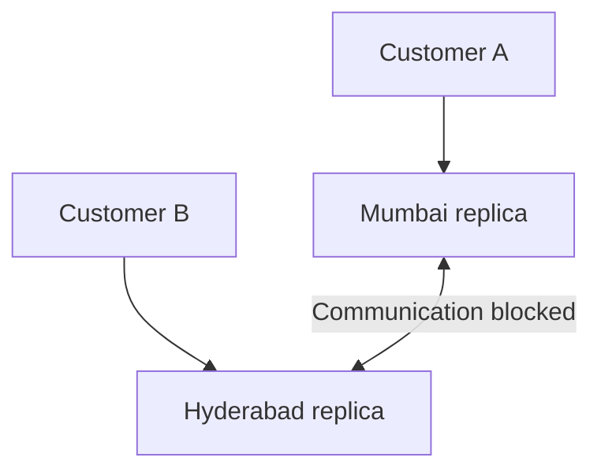
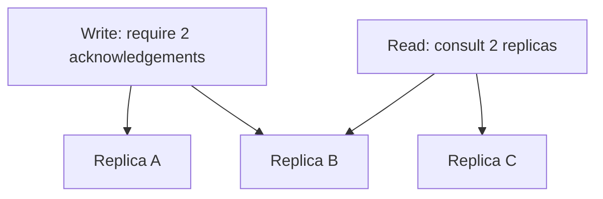

# CAP Theorem and Consistency in System Design

These notes explain:

- Why network failures create difficult choices in distributed systems.
- What consistency, availability, and partition tolerance mean.
- How different consistency models affect users.
- How quorums and conflict resolution help build practical systems.

---

# Part 1: Understand CAP

## 1. The Problem We Are Trying to Solve

Imagine an online shop selling a phone.

Only **one phone remains**, and the shop has database servers in two cities:

| Database | Available stock |
|---|---:|
| Mumbai | 1 |
| Hyderabad | 1 |

These are two copies of the **same inventory**, not two separate phones.

Normally, the servers communicate to keep their data updated.

Now imagine their network connection breaks.

Both servers are still running. Customers can reach them, but the servers cannot communicate with each other.

A customer buys the last phone through Mumbai.

Another customer asks Hyderabad:

> Is the phone still available?

Hyderabad has a problem:

- Its local data says `Stock = 1`.
- Mumbai might already have sold the phone.
- It cannot contact Mumbai to find out.

Should Hyderabad answer using its local data, or refuse the request until it can safely determine the answer?

**CAP explains why we cannot always guarantee both an up-to-date answer and a successful response during broken communication.**

---

## 2. Essential Background

### Node

A **node** is a computer or server participating in a system.

In our example:

- Mumbai database server = one node.
- Hyderabad database server = another node.

### Distributed system

A **distributed system** consists of multiple computers communicating over a network to perform work together.

Examples include:

- A database replicated across regions.
- Multiple application servers processing requests.
- A distributed storage service.

### Replica

A **replica** is a copy of data maintained on another node.

If Mumbai and Hyderabad both store the shop's inventory, they hold replicas of that inventory.

### Replication

**Replication** is the process of copying updates between replicas.

For example:

1. Mumbai changes stock from `1` to `0`.
2. The update is sent to Hyderabad.
3. Hyderabad also stores `Stock = 0`.

Replication may happen before the system confirms success, or asynchronously afterwards, depending on the design.

### Read and write

A **read** retrieves data:

> What is the available stock?

A **write** changes data:

> Reserve the last phone.

### Successful write

A successful write means the system has confirmed that the operation completed according to its guarantees.

This matters because sending a request is different from receiving confirmation that it succeeded.

> When discussing consistency, always identify when a write was confirmed successful.

---

## 3. What Happens When the Network Breaks?

A **network partition** occurs when communication is interrupted between parts of a distributed system.

Both replicas may still:

- Be running.
- Accept client connections.
- Read their local data.

But they cannot exchange updates.

### Partition versus server crash

| Failure | What happens? |
|---|---|
| Server crash | A server stops working |
| Network partition | Servers may keep working but cannot communicate across the split |

A partition can result from broken links, routing problems, firewall changes, or other communication failures.

In practice, long delays can also make communication unusable. A node generally cannot immediately distinguish a crashed peer from a slow or unreachable peer.

> A healthy server does not necessarily have a healthy connection to every other server.

---

## 4. Consistency: What Should a Read Return?

In CAP, consistency means clients observe the data **as if there were one copy**, with operations taking effect in an order that respects real time.

This guarantee is called **linearizability**.

A useful beginner version is:

> After a write completes successfully, a later read must not return an older value.

### Example

Initially:

| Replica | Stock |
|---|---:|
| Mumbai | 1 |
| Hyderabad | 1 |

A reservation completes successfully:

> Stock is now `0`.

A read started afterwards should return:

> Stock = 0

It must not return the old value `1`, assuming no later write changes the stock again.

### What if a read overlaps a write?

Suppose the reservation is still in progress when another customer reads the stock.

Depending on how the overlapping operations are ordered, the read may return `1` or `0`.

The important rule is:

> Once the reservation has completed, a read started afterwards cannot behave as though that reservation never happened.

### Must every replica update immediately?

No.

The guarantee concerns what **clients observe**.

An older replica might:

- Forward the request to an authoritative node.
- Wait until it catches up.
- Consult other replicas.
- Refuse the operation when it cannot safely answer.

The system does not have to update every physical copy before every successful response.

> CAP consistency describes observable behaviour, not identical data in every replica at every instant.

---

## 5. Availability: Must Every Functioning Node Serve Requests?

In CAP, availability means:

> Every request received by a non-failing node eventually completes with a valid response for that operation.

For a read, this means returning a value. For a write, it means completing the write according to the operation's contract.

An available system may return stale data if it does not also guarantee strong consistency.

### Example

Hyderabad cannot communicate with Mumbai.

Its local stock value is:

> Stock = 1

It continues serving stock reads using that value.

This preserves availability for those reads, even though the answer might be outdated.

### Does returning an error count?

Returning `503 Service Unavailable` because the node cannot safely process a request does not preserve CAP availability for that operation.

Simply returning an HTTP response is insufficient.

A normal business result, such as “item out of stock,” is different from refusing to perform the operation because coordination is unavailable.

### Availability versus uptime

These are different ideas:

| Concept | Meaning |
|---|---|
| Operational availability | How reliably a service meets its operational goals, often measured as uptime or successful-request percentage |
| CAP availability | Every request to a non-failing node eventually completes |

CAP availability also does not specify a response-time target such as `200 ms`.

> A service can have excellent uptime while deliberately giving up CAP availability for some operations during a partition.

---

## 6. Partition Tolerance

Partition tolerance means the system is designed to handle execution despite communication failures between nodes.

It does **not** mean that all features must remain fully available.

During a partition, a system might:

- Preserve consistency and refuse some requests.
- Continue accepting requests while allowing replicas to diverge.

For geographically distributed replicas, broken communication is a failure condition that must be considered.

We cannot make the problem disappear by saying:

> We choose consistency and availability, so partitions will not happen.

> Partition tolerance means deciding what guarantees survive broken communication.

---

## 7. CAP Theorem, Step by Step

The CAP theorem says:

> A distributed system cannot guarantee both linearizable consistency and availability in the presence of network partitions.

Let us see why.

### Step 1: Both replicas start with the same value

| Replica | Stock |
|---|---:|
| Mumbai | 1 |
| Hyderabad | 1 |

### Step 2: Communication breaks

Mumbai and Hyderabad cannot exchange messages.

### Step 3: A write reaches Mumbai

A customer reserves the phone.

To preserve availability for this request, Mumbai completes the reservation and confirms:

> Reservation successful. Stock = 0.

### Step 4: A later read reaches Hyderabad

Another customer asks:

> What is the stock?

Hyderabad cannot distinguish between these two possibilities:

| Possibility | Actual stock |
|---|---:|
| No reservation happened in Mumbai | 1 |
| A reservation completed in Mumbai | 0 |

Its local state is the same in both cases.

### Step 5: Every option has a cost

| Hyderabad's action | Consequence |
|---|---|
| Return its old value `1` | Could violate consistency |
| Guess `0` | Could be wrong if no reservation occurred |
| Wait for communication to recover | Cannot guarantee completion during a lasting partition |
| Reject the request | Gives up availability for that request |

The system could instead have refused Mumbai's write. That would preserve consistency, but would also sacrifice availability.

**The network prevents the nodes from obtaining the information needed to guarantee both properties.**

---

## 8. CP Behaviour: Preserve Consistency

**CP** is common shorthand for preserving consistency while tolerating partitions, at the cost of availability for some operations.

During a partition:

- Some operations may continue.
- Other operations must wait or fail.

### Example: Reserving the last phone

Suppose three replicas exist, and the reservation protocol requires a majority.

A partition separates them into:

- Two replicas on one side.
- One replica on the other.

The side with two replicas may continue accepting reservations if the protocol safely authorizes it.

The isolated replica cannot independently confirm reservations.

It might return:

> Unable to complete the reservation right now. Please retry.

### Why does this help?

Both sides cannot independently promise the same last phone to different customers.

However, this requires a correct reservation protocol.

**Strongly consistent reads alone are insufficient.**

This sequence is still unsafe if implemented as separate operations:

1. Customer A reads stock `1`.
2. Customer B reads stock `1`.
3. Both decide to buy.
4. Both update the stock.

The stock check and reservation need an atomic operation or suitable transaction.

### Important point

> CP does not mean the entire system shuts down during every partition.

A side with sufficient authority may continue. Some operations or regions lose availability.

---

## 9. AP Behaviour: Preserve Availability

**AP** is common shorthand for continuing to serve requests during partitions while allowing the system to give up linearizable consistency.

### Example: A like counter

A post initially has `100` likes.

During a partition:

- Mumbai accepts five new likes.
- Hyderabad accepts three new likes.

Both sides continue serving users.

They may temporarily display:

| Replica | Displayed likes |
|---|---:|
| Mumbai | 105 |
| Hyderabad | 103 |

After communication recovers, the system can reach `108` **if it tracks the independent increments correctly**.

It cannot simply add `105 + 103`, because both totals include the original `100`.

### What happens after the partition?

The system needs a replication and reconciliation strategy.

For example:

- Exchange missed updates.
- Deduplicate repeated events.
- Merge independent increments.
- Resolve conflicting writes.

### Important point

> Choosing availability does not automatically provide eventual convergence or safe merging.

Those require additional mechanisms.

AP behaviour can suit operations where temporary differences are acceptable and conflicts can be handled safely.

---

## 10. What About CA?

You may hear:

> CAP means choosing any two of C, A, and P.

This is misleading.

The useful question is:

> When communication breaks, can the system still guarantee both consistency and availability?

CAP says it cannot guarantee both under those conditions.

Without a partition, a system may provide both.

### Why is a single database sometimes called CA?

A single database avoids the problem of coordinating multiple replicas across a partition.

But that does not establish a useful strategy for a partitioned, replicated system.

Also, a server crash is a different failure from a network partition.

> Treat CA as a discussion about assumptions, rather than a third solution to the partition problem.

---

## 11. Common CAP Misconceptions

| Misconception | Better understanding |
|---|---|
| Choose two properties forever | The unavoidable C/A conflict concerns partitions |
| CP means everything stops | Some operations or nodes may continue safely |
| AP means data is always wrong | Data may be current, but linearizable behaviour is not guaranteed |
| A `503` response preserves availability | Refusing the operation sacrifices availability for it |
| Replication guarantees strong consistency | The replication and coordination protocols determine the guarantee |
| The whole application must be CP or AP | Different operations and data can have different requirements |
| CAP consistency prevents every business error | Transactions, atomicity, constraints, and application rules also matter |

---

# Part 2: Understand Consistency Models

## 12. What Is a Consistency Model?

A consistency model describes:

> What values clients are allowed to observe, and in what order.

Imagine updating your city:

> Hyderabad → Bengaluru

Now ask:

- Must everyone immediately see Bengaluru?
- Must you see your own change?
- Can a refresh show Hyderabad after you already saw Bengaluru?
- Can related updates appear in the wrong order?

Different models answer different questions.

These models are **not all steps on one simple ladder**. Some provide different, overlapping guarantees.

---

## 13. Strong and Eventual Consistency

### Strong consistency

In these notes, **strong consistency** means linearizability.

After a write completes, later reads observe that write or a later one.

#### Example

1. A setting changes from `Notifications ON` to `Notifications OFF`.
2. The system confirms success.
3. A later read returns `OFF`, unless another update changes it again.

#### Benefits

- Easier reasoning about current values.
- Useful when stale reads are unacceptable.
- Supports correctness when combined with suitable atomic operations.

#### Costs

- May require coordination.
- Can increase latency.
- Some operations may become unavailable during partitions.

### Eventual consistency

Eventual consistency means:

> If updates stop, communication recovers, and replication continues successfully, replicas eventually converge.

#### Example

A user changes their profile picture.

Immediately afterwards:

| Client | Picture |
|---|---|
| Phone | New picture |
| Desktop | Old picture |

Later, both display the new picture.

#### What does “eventually” mean?

The basic guarantee does not specify a fixed deadline.

It does not mean:

> Every replica updates within five seconds.

That would require an additional bound.

#### Benefits

- Can support local operations with less immediate coordination.
- Can support higher availability during partitions.
- Often helps reduce latency.

#### Costs

- Users may see stale values.
- Concurrent writes may conflict.
- Convergence requires a defined reconciliation strategy.

### Comparison

| Question | Strong consistency | Eventual consistency |
|---|---|---|
| Can a later read return an older value after a completed write? | No, under the stated guarantee | Yes |
| Must replicas converge eventually? | Client behaviour already follows a single-copy ordering | Yes, under the convergence conditions |
| Does the model alone guarantee fast responses? | No | No |
| Does it automatically prevent double booking? | No; atomic reservation logic is also needed | No |
| Can it support fully available operations during partitions? | Not together with the strong guarantee | Potentially, depending on the design |

---

## 14. Read-Your-Writes and Monotonic Reads

### Read-your-writes

After you successfully change data, your later reads reflect your own change or a later applicable version.

#### Example

1. Charan changes his city to Bengaluru.
2. The save succeeds.
3. Charan refreshes his profile.
4. He sees Bengaluru.

Other users might temporarily see Hyderabad.

This prevents the experience:

> I saved my change, but it disappeared.

#### Possible implementation approaches

- Read from the primary after writing.
- Track a version token and read from a replica that has reached it.
- Route requests to a replica known to contain the write.

Simply using the same replica is insufficient if that replica has not applied the write.

### Monotonic reads

Once you have seen a version, later reads in the relevant session do not move backwards to an older version.

#### Example

| Request | Version returned |
|---|---:|
| First read | 5 |
| Second read | 5 or newer |

Returning version `3` on the second read would violate monotonic reads.

### How are they different?

| Guarantee | Protects |
|---|---|
| Read-your-writes | Visibility of your own completed writes |
| Monotonic reads | Progress through versions you have already observed |

You may need both.

---

## 15. Monotonic Writes

Monotonic writes preserve the order of writes from the same client or session.

### Example

Charan updates a setting twice:

1. Theme = Dark.
2. Theme = Light.

The system should apply these writes in that order.

If one replica applies `Light` first and then the older `Dark` update, the final result is incorrect for the intended sequence.

### What does this not guarantee?

It does not by itself order every write from every user.

If another user changes the same setting concurrently, additional rules are needed.

> Monotonic writes preserve a client's write order, not a universal order across all clients.

---

## 16. Causal Consistency

Causal consistency preserves dependencies between operations.

If one operation depends on another, observers must see them in an order that respects that dependency.

### Example: Post and reply

1. Charan creates a post: “I got a new job!”
2. Rahul reads that post.
3. Rahul replies: “Congratulations!”

The reply depends on the post.

A causally consistent view must not expose the reply while omitting the post it depends on.

### What about unrelated posts?

Two users might create unrelated posts at the same time.

Different clients may see those posts in different orders.

Causal consistency does not require one global order for all unrelated events.

> Preserve cause before effect; allow flexibility for independent operations.

---

## 17. Consistent-Prefix Reads

A prefix is the beginning of a sequence.

Suppose an ordered event history is:

1. Order created.
2. Payment recorded.
3. Order shipped.
4. Order delivered.

Valid prefixes include:

- `[Order created]`
- `[Order created, Payment recorded]`
- `[Order created, Payment recorded, Order shipped]`

A consistent-prefix view does not expose a history such as:

> `[Order created, Order shipped]`

while skipping the earlier payment event from that same ordered history.

### Important distinction

A page displaying only the current status `Delivered` does not violate this guarantee.

A status display is not necessarily showing the event history.

The guarantee concerns the ordering and completeness of the prefix exposed from an ordered sequence.

Also, whether a client's later reads can move to an older prefix depends on additional guarantees, such as monotonic reads.

---

## 18. Session Consistency

A session is a sequence of interactions associated with a client or user context.

Session consistency provides defined guarantees within that context.

Depending on the system, these can include:

- Read-your-writes.
- Monotonic reads.
- Monotonic writes.
- Preserving dependencies between reads and later writes.

### Example

Within a session, Charan:

1. Creates a task.
2. Sees the task immediately.
3. Edits the task.
4. Continues seeing the edited version.

Another user's session may temporarily see older data.

### Important limitation

The exact meaning of “session consistency” depends on the system.

Check:

- Which guarantees are included.
- How sessions are identified.
- Whether tokens must be passed between requests.
- What happens when the session moves to another device.

> A session guarantee does not automatically apply across every device or independent login.

---

## 19. Consistency Model Comparison

| Model or guarantee | Main promise | Example |
|---|---|---|
| Strong consistency / linearizability | Operations behave like one copy, respecting real-time order | A read after a completed update sees that update or a later one |
| Eventual consistency | Replicas converge after updates stop and synchronization succeeds | Profile pictures eventually match |
| Read-your-writes | Your later reads reflect your own completed writes | Your saved profile change remains visible |
| Monotonic reads | Later reads do not return older observed versions | Refresh does not move from version 5 to version 3 |
| Monotonic writes | One client's writes are applied in order | Dark theme update precedes the later Light update |
| Causal consistency | Dependencies are observed in order | A post is visible with its dependent reply |
| Consistent prefix | An observed ordered history does not skip earlier entries | A log shows a valid beginning of its sequence |
| Session consistency | Specified guarantees hold within a session | One session maintains its own view of progress |

---

# Part 3: Apply the Ideas

## 20. Quorums

A quorum is a required set or number of replicas participating in an operation.

For a simple replicated read/write setup:

| Symbol | Meaning |
|---|---|
| `N` | Total replicas for the data |
| `W` | Replicas that must acknowledge a write |
| `R` | Replicas consulted for a read |

Assume:

> N = 3, W = 2, R = 2

### Example

A write reaches replicas A and B.

A read consults replicas B and C.

The sets overlap at B.

### Why is `R + W > N` useful?

With a fixed set of `N` replicas, it guarantees that any read set of size `R` overlaps any write set of size `W`.

For this example:

> 2 + 2 > 3

This is a mathematical overlap guarantee, not merely a higher probability of overlap.

### Does overlap guarantee linearizability?

No.

The protocol must also handle issues such as:

- Concurrent writes.
- Version ordering.
- Incomplete writes.
- Replica membership changes.
- Selecting and propagating the correct value.

Some systems use fallback replicas, often called sloppy quorums, which change the simple overlap assumptions.

### Common configurations

| Configuration | Practical implication |
|---|---|
| `W = 1, R = 3` | Writes need fewer acknowledgements; reads require all three replicas |
| `W = 3, R = 1` | Writes require all three replicas; reads consult one |
| `W = 2, R = 2` | Both reads and writes require a majority |

Latency and correctness depend on the full protocol, not only these numbers.

### Behaviour during a partition

With three replicas split into groups of two and one, an operation requiring two replicas cannot complete on the isolated side.

> Quorums help implement trade-offs; they do not remove CAP's limitation.

---

## 21. Conflict Resolution

If multiple replicas accept independent writes, they may later disagree.

Initially:

> City = Hyderabad

During a partition:

| Replica | Update |
|---|---|
| Mumbai | City = Bengaluru |
| Hyderabad | City = Mumbai |

After reconnection, the system needs a rule.

### 21.1 Last-write-wins

Keep the value with the greatest timestamp according to the system's ordering rule.

Example:

| Timestamp | Value |
|---|---|
| 10:00:01 | Bengaluru |
| 10:00:02 | Mumbai |

The selected value is Mumbai.

#### Limitations

- Clocks may disagree.
- One update is discarded.
- “Largest timestamp” may not match the real-world last action.

Use it only where losing an overwritten update is acceptable.

### 21.2 Application-level merging

Merge according to business rules.

Example:

- One device adds a laptop.
- Another adds a mouse.
- The merged cart contains both.

However, removals and quantities need careful handling.

A simple set union could accidentally restore an item that a user deliberately removed.

### 21.3 Version numbers and vector clocks

A basic version number can help track progress in a controlled ordering.

A vector clock tracks enough information to distinguish:

- One update that follows another.
- Concurrent updates that neither includes.

Vector clocks help **detect** conflicts.

They do not decide the correct business resolution by themselves.

### 21.4 Conflict-free replicated data types

A **CRDT** is a data structure with operations or merge rules designed so independently updated replicas can converge under specified conditions.

Examples include specialized:

- Counters.
- Sets.
- Registers.
- Maps.

For a counter, each replica might track its own increments.

| Replica | New increments |
|---|---:|
| Mumbai | 5 |
| Hyderabad | 3 |

The system combines those increments with the original `100` to get `108`.

CRDTs require suitable rules for duplicate messages, retries, and the supported operations.

> Conflict resolution is part of the data design, not a cleanup step to invent after deployment.

---

## 22. CAP Consistency Versus ACID Consistency

These use the same word for different concepts.

| Concept | Main question |
|---|---|
| CAP consistency | Do clients observe operations as if there were one copy, respecting real-time order? |
| ACID consistency | Does a transaction preserve the application's defined rules and constraints? |

### Example

A database has a rule:

> Inventory must not become negative.

A transaction that preserves this rule contributes to ACID consistency.

A replica that returns stock `1` after stock `0` was successfully written raises a CAP consistency issue.

### What else matters?

Correct reservation behaviour may require:

- An atomic stock check and decrement.
- Suitable transaction isolation.
- Constraints.
- Correct application logic.

Correct payment processing may also require:

- Idempotency.
- Deduplication.
- Reliable state transitions.
- Coordination with external providers.

> A consistent read is one building block of correctness, not the whole solution.

---

## 23. PACELC

CAP focuses on partitions.

PACELC also highlights trade-offs during normal communication.

It can be read as:

> If there is a Partition, consider Availability versus Consistency. Else, consider Latency versus Consistency.

### Example: India and Europe

An update arrives in India.

#### Approach A: Coordinate before acknowledging

The system waits for the required remote coordination before confirming success.

This can support stronger guarantees, but adds network latency.

#### Approach B: Acknowledge locally

The system confirms the update in India and sends it to Europe afterwards.

This can reduce local write latency, but a read in Europe may temporarily return older data unless the read path adds coordination.

### Important clarification

Strong consistency does not always require waiting for every replica.

The required communication depends on the protocol, replica placement, leader, and quorum rules.

> PACELC reminds us to examine normal-operation latency as well as failure behaviour.

---

## 24. Design One Realistic Application

Consider an e-commerce application.

Different operations have different risks.

| Operation | Desired behaviour | Possible approach |
|---|---|---|
| Browse descriptions | Briefly stale text is acceptable | Eventual consistency |
| Read product reviews | Temporary delay is acceptable | Eventual consistency |
| Update personal preferences | User should see their own changes | Read-your-writes or session guarantees |
| Add items to cart | Cart should remain usable; concurrent edits need rules | Local updates with defined reconciliation |
| Reserve the last item | Avoid promising the same stock twice | Atomic reservation with suitable coordination |
| Process a payment | Avoid duplicate charges and invalid state changes | Idempotency, durable records, and appropriate transactions |
| Display a view counter | Small temporary differences are acceptable | Eventual convergence or a suitable counter design |

### A useful distinction

A payment confirmation screen might use read-your-writes so the payer sees the completed action.

A payment ledger needs stronger correctness guarantees.

An analytics report about payments may update asynchronously.

These are different operations involving related data.

> Choose guarantees according to the operation and its consequences.

---

## 25. A Decision Checklist

### 1. What exactly is the operation?

Be specific.

“Payments” is broad.

“Record a payment attempt with a unique idempotency key” is concrete.

### 2. What can go wrong if the data is stale?

Examples:

- Old product description: usually minor.
- Old inventory used for a reservation: potentially costly.
- Old permissions after access is revoked: potentially serious.

### 3. What is worse during a partition?

- Refusing the operation?
- Returning an older value?
- Accepting a write that may conflict later?

There is no universal answer.

### 4. Can concurrent updates be merged safely?

Adding independent counter increments is easier to merge than two conflicting edits to a delivery address.

### 5. Does the user need to see their own changes?

If yes, consider read-your-writes.

### 6. Must reads avoid moving backwards?

If yes, consider monotonic reads.

### 7. Do operations depend on earlier operations?

If yes, consider causal ordering or stronger coordination.

### 8. Does correctness require an atomic operation?

For inventory, separately reading and updating stock may be unsafe.

Define the operation that must happen atomically.

### 9. What latency is acceptable?

Cross-region coordination can affect response time.

Decide where coordination is necessary.

### 10. What happens after connectivity returns?

Define:

- How replicas exchange updates.
- How conflicts are detected.
- How conflicts are resolved.
- How retries are deduplicated.
- How clients learn the final outcome.

---

## 26. Quick Revision

### CAP properties

| Property | Beginner-friendly meaning |
|---|---|
| Consistency | Clients observe one logical copy that respects completed operations |
| Availability | Requests to functioning nodes eventually complete |
| Partition tolerance | The design handles interrupted communication between nodes |

### CP versus AP

| Behaviour | Preserves during a partition | Possible consequence |
|---|---|---|
| CP | Linearizable consistency | Some requests wait or fail |
| AP | Availability | Reads may be stale; accepted writes may conflict |

### Remember these points

1. CAP concerns what can be guaranteed during network partitions.
2. Returning an error does not automatically preserve availability.
3. CP systems may continue operating on an authorized side.
4. AP systems need explicit replication and reconciliation rules.
5. Strong consistency does not replace atomic operations or transactions.
6. Eventual consistency does not specify a convergence deadline.
7. Quorum overlap alone does not prove linearizability.
8. Different operations can need different guarantees.

### Self-check questions

**Question 1**

A write completes in Mumbai. A later read in Hyderabad returns the old value.

Which guarantee is violated?

**Answer:** Linearizable consistency, assuming no later write restored that value.

---

**Question 2**

An isolated node returns `503` because it cannot safely confirm a reservation.

Has it preserved CAP availability for that request?

**Answer:** No. It refused the operation to protect correctness.

---

**Question 3**

A user sees their saved profile change, while another user temporarily sees the old profile.

Which guarantee might be present?

**Answer:** Read-your-writes for the first user. This does not establish strong consistency for everyone.

---

**Question 4**

Does `R + W > N` automatically guarantee linearizability?

**Answer:** No. It guarantees set overlap under the stated replica assumptions. The rest of the protocol still matters.

---

**Question 5**

Can two strongly consistent reads of stock `1` still lead to double booking?

**Answer:** Yes. If checking and reserving are separate operations, both customers can act on the same stock. Use an atomic reservation or suitable transaction.

---

**Question 6**

Does an AP design automatically merge two like counters correctly?

**Answer:** No. It needs a mechanism that tracks and merges updates without double counting or losing them.

---

### One sentence to remember

> When replicas cannot communicate, a system cannot guarantee both a single up-to-date view and successful completion of every request to functioning nodes.
